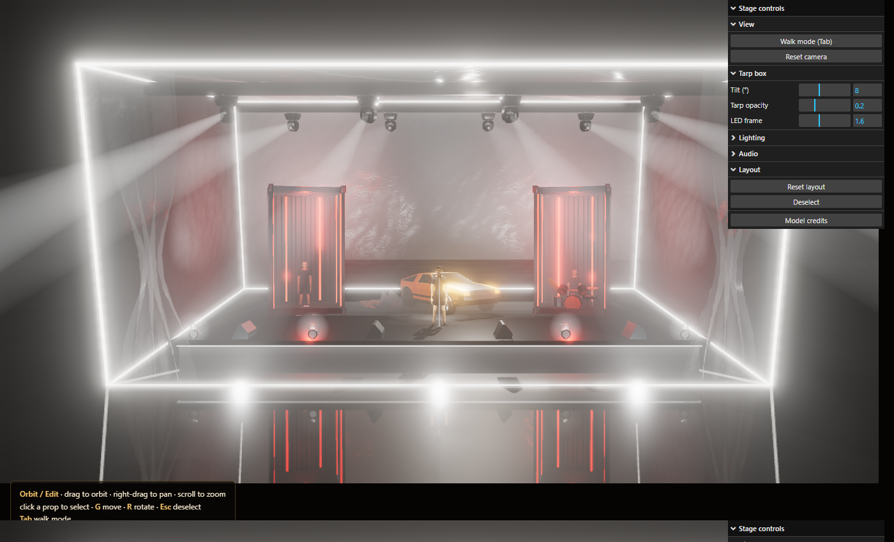
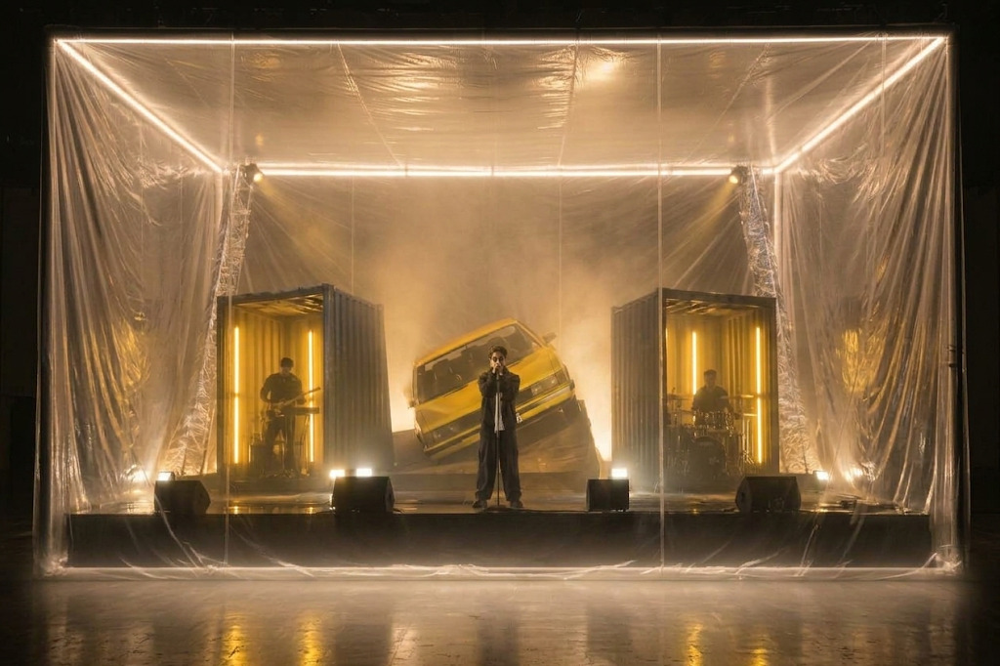

# Marshall Ahmad — Concert Stage Visualization

An interactive 3D visualization of a concert stage set, built with three.js. A tilted
clear-tarp box with LED-edged frame encloses a stage with two shipping containers
(keys and drums), a yellow 80s coupe, and a singer out front. Walk the set, rearrange
props, and watch the lighting react to music — a built-in beat or a song you load.



Reference the design was based on:



## Features

- **Tarp box** rotated as a rigid body (default 8°, back raised) with glowing LED edges
- **Containers** standing on end, open toward the audience, lit with red light bars
- **Concert rig** — 8 moving heads on two roof trusses cycling fan / ballyhoo / cross / singer patterns
- **Sound-reactive** under-stage glow and beam intensity, driven by a Web Audio analyser
- **Song input** — load or drag-and-drop any audio file (played locally, never uploaded)
- **Free camera** — orbit + WASD, or a pointer-lock walk mode
- **Editable layout** — click a prop and move/rotate it; layout persists in the browser
- Control panel for tilt, colors, haze, bloom, exposure, and audio

## Prerequisites

- Node.js 18+ and npm
- A desktop browser with WebGL2 (Chrome, Edge, Firefox)

## Install and run

```bash
npm install
npm run dev        # http://localhost:5173
```

Production build:

```bash
npm run build      # outputs to dist/
npm run preview    # serve the build locally
```

## Controls

| Input | Action |
| --- | --- |
| Drag / right-drag / scroll | Orbit / pan / zoom |
| `W` `A` `S` `D` | Move (hold `Shift` to go faster) |
| `Q` / `E` | Down / up |
| `Tab` | Toggle walk mode (mouse look) |
| Click a prop | Select it |
| `G` / `R` | Move / rotate gizmo |
| `Esc` | Deselect (or leave walk mode) |

Shareable camera views: `?cam=x,y,z&look=x,y,z` (add `&skip` to bypass the intro).

## Deploying

The project is a static Vite site. On Vercel, import the repository — the Vite preset is
detected automatically (build command `npm run build`, output directory `dist`).

## Project structure

```
index.html          page shell, intro screen, credits dialog
public/models/      downloaded GLB models (see credits)
src/main.js         renderer, post-processing, control panel, render loop
src/set.js          tarp box, stage riser, floor reflection, haze, backlight
src/props.js        model loading/fitting, containers, car, performers, light rig
src/navigation.js   orbit / walk / transform controls, layout persistence
src/audio.js        synthesized beat, song playback, frequency analysis
```

## Credits

3D models from [Poly Pizza](https://poly.pizza) under CC0 and CC-BY 3.0 — full
attribution is listed in the in-app **Model credits** panel and in `src/props.js`.
