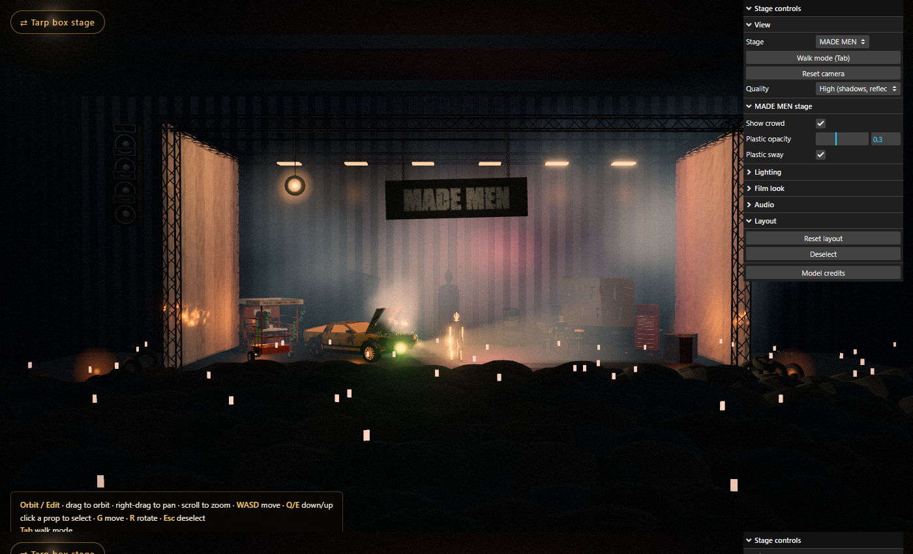

# Marshall Ahmad — Concert Stage Visualization

Interactive 3D visualizations of two concert stage sets, built with three.js:

- **Tarp box** — a tilted clear-tarp box with an LED-edged frame, two shipping containers
  (keys and drums), a yellow 80s coupe and a singer out front.
- **MADE MEN** — a dark warehouse stage wrapped in loose plastic under a steel truss: a rusty
  mustard car with flowers spilling from its open hood, a qingqi (chingchi) carrying the keys
  player, a mechanic's tool wall and red tool chest, tyre mounds, fire barrels, a weathered
  hanging sign and a ~250-person crowd.

Switch stages with the button top-left, or link straight to `?scene=tarp` / `?scene=mademen`.
Walk the sets, rearrange props, and watch the lighting react to music — a built-in beat or a
song you load.




Reference the design was based on:


## Features

- **Tarp box** rotated as a rigid body (default 8°, back raised) with glowing LED edges, open at the front
- **Plastic sheeting** — overlapping, layered strips settled by a cloth simulation (in a Web Worker), with crease lines and an optional gentle sway
- **Containers** standing on end, open toward the audience, lit with red light bars
- **Concert rig** — 8 moving heads on two roof trusses cycling fan / ballyhoo / cross / singer patterns
- **Sound-reactive** under-stage glow and beam intensity, driven by a Web Audio analyser
- **Song input** — load or drag-and-drop any audio file (played locally, never uploaded)
- **Free camera** — orbit + WASD, or a pointer-lock walk mode
- **Editable layout** — click a prop and move/rotate it; layout persists in the browser
- Control panel for tilt, colors, haze, bloom, exposure, and audio

## Prerequisites

- Node.js 18+ and npm
- A desktop browser with WebGL2 (Chrome, Edge, Firefox)

## Install and run

```bash
npm install
npm run dev        # http://localhost:5173
```

Production build:

```bash
npm run build      # outputs to dist/
npm run preview    # serve the build locally
```

## Controls

| Input | Action |
| --- | --- |
| Drag / right-drag / scroll | Orbit / pan / zoom |
| `W` `A` `S` `D` | Move (hold `Shift` to go faster) |
| `Q` / `E` | Down / up |
| `Tab` | Toggle walk mode (mouse look) |
| Click a prop | Select it |
| `G` / `R` | Move / rotate gizmo |
| `Esc` | Deselect (or leave walk mode) |

Shareable camera views: `?cam=x,y,z&look=x,y,z` (add `&skip` to bypass the intro).

## Deploying

The project is a static Vite site. On Vercel, import the repository — the Vite preset is
detected automatically (build command `npm run build`, output directory `dist`).

## Project structure

```
index.html              page shell, intro screen, stage switch, credits dialog
public/models/          meshopt-compressed GLB models; mademen/ holds that stage's props
src/main.js             engine: renderer, post-processing, shared controls; loads one stage
src/engine/             shared: navigation, audio, model helpers, cloth plastic, fx, colour grade
src/scenes/tarp/        tarp box stage: set, props, settings
src/scenes/mademen/     MADE MEN stage: warehouse, props, crowd, procedural materials
```

## Credits

3D models from [Poly Pizza](https://poly.pizza) under CC0 and CC-BY 3.0 — full
attribution is listed in each stage's in-app **Model credits** panel.
